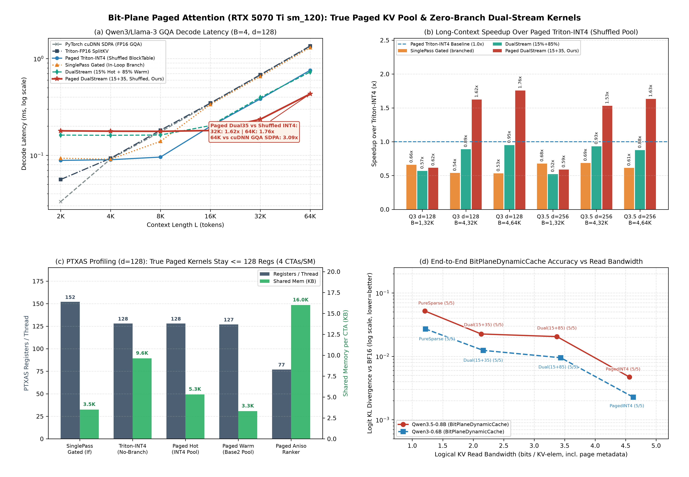

# Bit-Plane Paged Attention (`bitplane-paged-attn`)

**面向 GQA 与 Hybrid Attention 大模型的真物理页池位面渐进式 KV-Cache 解码与双流 Split-KV Triton 算子实现**


---

## 项目核心定位与学术边界说明

传统 KV-Cache 量化方案在写入时即静态锁死比特精度；而在长上下文推理中，不同 Query 对历史上下文页面（Page）的依赖度呈现高度稀疏且动态变化的特征。然而，算法层的理想稀疏率往往在 GPU 上受阻于两大工程瓶颈：**页内高精度分支引发的寄存器膨胀与占用率骤降**，以及 **GQA 多 Query 头独立选页造成的物理访存集合碎片化放大**。

本项目并不将“渐进式高低位面编码与自适应精度读取”单独声明为原创概念，而是明确将其定位为**面向 MLSys 的软硬协同推理系统方案**：

1. **面向 GQA 的组级共享各向异性页排序启发式（Anisotropic Group-Shared Page Ranking Heuristic）**：将物理页视作多维尺度包围体进行组级统一选页，引入 GQA 平局消解项并配合 Page-0 锚定机制，并通过真实模型 **Attention Mass Recall** 与 **Oracle Page Recall** 消融实验确立其工程有效性边界。
2. **零循环内门控分支的双流 Split-KV 物理调度与真 `PagedKVPool`**：将同一套物理 2+2 位面池彻底拆解为两支无控制流分支的轻量 Triton 算子（Hot 读 4-bit 完整精度、Warm 仅读 2-bit Base 位面、Skip 直接零读），配合支持乱序 `block_table`、Prefix Caching（引用计数 + 写时复制 CoW）和 Continuous Batching 的 **Block-First 4D** 物理页池，将 `d=128` 算子寄存器压低至 `<= 128`（`4 CTAs/SM`），消除与算子编译期相关的 GPU-CPU 同步障碍。
3. **端到端真省显存的 `BitPlaneDynamicCache`**：原生继承 `transformers` `CacheLayerMixin` 与 `Cache` 接口，在 Prefill 阶段即实时打包落池并释放原始全精度历史缓存，仅保留 `<= page_size` 的滑窗全精度 Tail，同时自动适配 `Qwen3` Dense 与 `Qwen3.5` Hybrid（`GatedDeltaNet` 线性状态层 + 全局注意力层）架构。

### 与相关研究工作的边界对比

| 相关工作 | 核心研究聚焦 | 与本项目的差异及定位界定 |
| :--- | :--- | :--- |
| **KIVI** (ICML 2024) | Key Per-Channel、Value Per-Token 静态低比特量化 | 基础量化直觉相似；本项目进一步解耦存储精度与每次 Decode 的实时读取精度 |
| **Quest** (ICML 2024) | Query 感知的页级稀疏 KV 筛选与全跳过 | 仅做“读/跳过”二元硬决策；本项目增加 **Warm 2-bit Base 位面渐进读取层**与统一 GQA 组内路由 |
| **KVTuner** (ICML 2025) | 层级静态/离线混合精度配比 | 静态按层分配固定位宽；本项目在运行时按 Page × KV-Head 动态分级读写 |
| **PM-KVQ** (ICLR 2026) | 渐进式混合精度 KV 量化编码 | 编码层面思想相关；本项目重在 GPU **双流 Split-KV 算子寄存器控制与真实 Paged 页表访存** |
| **Lynx** (2026.07) | 高低有效位分流与渐进式传输 | 聚焦跨层/传输分级分流；本项目聚焦片上 **GQA 组级共享路由 + Triton 无分支双核执行体系** |
| **ReadKV** (2026.10, `arXiv:2610.11245`) | Query 自适应渐进式 KV 精度读取 | 算法主思路高度重合；因此本项目不把位面动态读取本身当成核心原创，而是聚焦 **GQA 共享各向异性排序实证、零分支双流 Split-KV + 乱序页表真内核与 `BitPlaneDynamicCache` 真机显存压缩系统** |

---

## 核心技术与架构原理

### 1. 存储-读取解耦的嵌套 2+2 位面物理池（Reversible 2+2 Bit-Plane）

物理页池 `PagedBitPlaneKVPool` 对每个满页（`page_size = 32`）按组量化为无符号 4-bit 整数 $q_4 \in \{0, \dots, 15\}$，并将其无损拆分为高 2-bit **Base Plane** ($q_{\text{base}} \in \{0,1,2,3\}$) 与低 2-bit **Residual Plane** ($q_{\text{res}} \in \{0,1,2,3\}$)，每 4 个分量紧密打包成 1 个 `uint8`：

$$q_4 = 4 q_{\text{base}} + q_{\text{res}}, \qquad \hat{x}_4 = m + s (4 q_{\text{base}} + q_{\text{res}}), \qquad \hat{x}_2 = m + s (4 q_{\text{base}} + 1.5)$$

- **可逆的渐进读取与误差界**：当前 Query 对 Warm Page 仅读取高 2-bit `Base Plane` 时，无需回写或重新量化存储；后续 Query 需要高精度时仍可随时访问原址 `Residual Plane`。该粗粒度读取相对于 **INT4 表示** 的最大额外重建误差严格有界：

$$|\hat{x}_4 - \hat{x}_2| \le 1.5 s$$

  *(注：上述“无损”特指位面重组等价于原始 INT4 量化存储，并非相对于原始 BF16/FP16 张量无损。)*

- **Block-First 4D 物理布局 & 完整 PagedAttention 机制**：物理池以 `[num_blocks, num_kv_heads, page_size, head_dim // 4]` 组织，彻底消除连续大张量假设；支持动态按页扩容、变长请求填充（`num_pages_host` / `tail_lens_host` 零同步元数据）、`fork_sequence()` 共享前缀页哈希命中、`ref_count` 引用计数与 **Copy-on-Write (CoW)** 增量页面写时复制。

### 2. GQA 组级共享各向异性页排序启发式（Anisotropic Page Ranking Heuristic）

在 GQA 中，同一 KV Head 服务多个 Query Head（如 `Qwen3` 中 $G=4$），我们对每页构造各向异性中心与半径向量 $c_p = k_{\min} + 7.5 s$、$r_p = 7.5 s$，由单卡 Triton Ranker 核计算每组内各头统一排序分：

$$u(q, p) = q^\top c_p + \beta \sqrt{\sum_{i=1}^{d} q_i^2 r_{p,i}^2}, \qquad S(p) = \max_{g \in G} u(q_g, p) + 10^{-5} \sum_{g \in G} \exp\big(u(q_g, p) - \max_{g'} u(q_{g'}, p)\big)$$

- **理论诚实性声明**：对于逐维包围盒 $\mathcal{B}_p = \{k : |k_i - c_{p,i}| \le r_{p,i}\}$，严格的线性点积上界应为 $\max_{k \in \mathcal{B}_p} q^\top k = q^\top c_p + \sum_i |q_i| r_{p,i}$（即 `box_l1`）；我们的椭圆式表达 $u(q,p)$ 在通用 $\beta=1.5$ 下**不是数学意义上的最坏盒严格上界**。然而实证表明：$\ell_1$ 盒上界会受维度奇异离群值惩罚而在真实注意权重下大幅劣化排序质量，而各向异性启发式排序能在显著降低奇异维误选率的同时高效召回真实注意力质量（见下方消融表）。

### 3. 零循环内分支双流 Split-KV 执行引擎（Eliminating Register Spilling）

在单核内使用 `if tier == HOT ... else ...` 门控会迫使编译器拉升活寄存器至 `152 regs/thread`（`3 CTAs/SM`），导致实际推理倒退为负优化。本项目采用三阶段无循环门控执行流水线：

1. `_paged_anisotropic_score_kernel`（`77 regs`, `6 CTAs/SM`）：按物理页表读取尺度矢量，并行产出组级路由分；
2. 零 `.item()` 同步顶优路由：通过 `UNIFORM_N_SEL` 常量折叠与 host 侧固定元信息，分配 `Hot (top 15%)` 与 `Warm (next 35%)` 物理索引数组，其余页面零物理读取；
3. 两支专注算子 + `_paged_dualstream_agg_and_tail_kernel`：
   - `_paged_indexed_int4_splitkv_kernel`（`128 regs`, `4 CTAs/SM`）仅处理 Hot 页表，完整加载 `Base + Residual` 4-bit 位面；
   - `_paged_indexed_base2_splitkv_kernel`（`127 regs`, `4 CTAs/SM`）仅处理 Warm 页表，**物理层跳过全部 Residual 张量**；
   - 在线 Log-Sum-Exp 融合 `Hot + Warm + Full-Precision Tail`。

---

## 全量实测表现（NVIDIA GeForce RTX 5070 Ti `sm_120`）

> 硬件与软件环境：`NVIDIA GeForce RTX 5070 Ti (15.89 GB, 70 SMs, Blackwell sm_120)`、`Python 3.11.9`、`PyTorch 2.9.1+cu128`、`Triton 3.5.1`、`Transformers 5.24.1`。



### 1. 长上下文单算子 Decode 延迟与乱序页表开销（`float16`, `page_size=32`, `Hot 15% + Warm 35%`）

*(注：下表中的 `cuDNN SDPA` 使用 PyTorch 原生支持 GQA 的 `enable_gqa=True` 后端直接评测，不做伪造扩张；对于 `d=256`，PyTorch 当前后端 `cuDNN/Flash SDPA` 尚不支持 `head_dim > 128`，故客观标记为 `N/A`。物理池与 Triton-INT4 的 `Paged` 版本均跑在全随机洗牌后的乱序 `block_table` 上。)*

| 规格与批次 | `cuDNN GQA SDPA` (ms) | `Triton-FP16` (ms) | `Triton-INT4` (ms) | `Paged Triton-INT4` (ms) | `SinglePass Gated` (ms) | `DualStream (15+35)` (ms) | `Paged Dual35` (ms, Ours) | 加速 vs `Paged INT4` | 加速 vs `cuDNN SDPA` | 加速 vs `FP16` | 乱序页表开销 |
| :--- | :---: | :---: | :---: | :---: | :---: | :---: | :---: | :---: | :---: | :---: | :---: |
| **`d=128` (`32Q/8KV`), `B=1, L=64K`** | 0.338 | 0.358 | 0.195 | 0.199 | — | 0.165 | **0.182** | **1.10×** | **1.86×** | **1.97×** | +10.1% |
| **`d=128` (`32Q/8KV`), `B=4, L=32K`** | 0.675 | 0.681 | 0.352 | 0.383 | 0.654 | 0.234 | **0.236** | **1.62×** | **2.86×** | **2.89×** | **+0.8%** |
| **`d=128` (`32Q/8KV`), `B=4, L=64K`** | 1.333 | 1.352 | 0.691 | 0.758 | 1.301 | 0.424 | **0.431** | **1.76×** | **3.09×** | **3.13×** | **+1.7%** |
| **`d=256` (`16Q/4KV`), `B=1, L=64K`** | N/A | 0.690 | 0.246 | 0.290 | — | 0.167 | **0.184** | **1.58×** | N/A | **3.75×** | +10.0% |
| **`d=256` (`16Q/4KV`), `B=4, L=32K`** | N/A | 0.684 | 0.388 | 0.392 | 0.566 | 0.246 | **0.256** | **1.53×** | N/A | **2.67×** | +4.3% |
| **`d=256` (`16Q/4KV`), `B=4, L=64K`** | N/A | 1.351 | 0.672 | 0.761 | 1.095 | 0.461 | **0.466** | **1.63×** | N/A | **2.90×** | **+1.1%** |

- **页池静态存储容量压缩**：在 `B=4, L=64K` 下，`d=128` 单层 KV 池由 FP16 等价 **`1024.0 MB` 压缩至 `296.36 MB`（`3.46×`**，计入全部 `min/scale` 等量化参数后等价 **`4.63 bits/elem`**）；`d=256` 压缩至 **`292.36 MB`（`3.50×`**，等价 **`4.57 bits/elem`**）。

### 2. PTXAS 硬件编译资源剖析（`B=4, num_warps=4`）

| Kernel 模块 | `d=128` Regs/Thread | `d=128` Shared Mem | `d=128` Max CTAs/SM | `d=256` Regs/Thread | `d=256` Shared Mem | `d=256` Max CTAs/SM |
| :--- | :---: | :---: | :---: | :---: | :---: | :---: |
| `singlepass_gated` (有循环门控) | 152 | 3,584 B | 3 | 235 | 7,168 B | 2 |
| `int4_splitkv` (无分支基准) | 128 | 9,856 B | 4 | 243 | 19,584 B | 2 |
| **`paged_anisotropic_score` (Ranker)** | **77** | **16,384 B** | **6** | **162** | **32,768 B** | **3** |
| **`paged_hot_int4` (物理池 Hot)** | **128** | **5,444 B** | **4** | **244** | **10,820 B** | **2** |
| **`paged_warm_base2` (物理池 Warm)** | **127** | **3,396 B** | **4** | **221** | **6,724 B** | **2** |

### 3. 各向异性页排序启发式实证：真实 Attention Mass Recall 消融（`P=63, Hot=15%, Warm=35%`）

| 模型 (全真实前向抽取) | 指标 | `center` ($\beta=0$) | `anisotropic` ($\beta=0.5$) | `anisotropic` ($\beta=1.0$) | **`anisotropic` ($\beta=1.5$, 默认)** | `anisotropic` ($\beta=2.0$) | `box_l1` (严格盒边界) |
| :--- | :--- | :---: | :---: | :---: | :---: | :---: | :---: |
| **`Qwen3.5-0.8B`** | Top-15% Mass / Pin-0 | 79.5% / 78.3% | 80.0% / 78.8% | 80.7% / 80.4% | **82.1% / 81.4%** | 82.2% / 81.5% | 74.3% / 73.9% |
| (`6` 全局层) | Top-50% Mass / Pin-0 | 94.9% / 94.9% | 95.1% / 95.1% | 95.2% / 95.2% | **95.3% / 95.3%** | 95.3% / 95.3% | 91.9% / 91.7% |
| | Oracle Top-15% Page Recall | 71.7% | 72.9% | 74.0% | **74.8%** | 74.4% | 59.3% |
| **`Qwen3-0.6B`** | Top-15% Mass / Pin-0 | 78.8% / 86.1% | 82.4% / 86.0% | 84.7% / 85.9% | **85.0% / 85.4%** | 84.4% / 84.5% | 73.2% / 76.2% |
| (`28` 全局层) | Top-50% Mass / Pin-0 | 95.2% / 96.1% | 95.9% / 96.2% | 96.2% / 96.1% | **96.0% / 96.0%** | 95.8% / 95.7% | 90.5% / 90.5% |
| | Oracle Top-15% Page Recall | 76.7% | 77.2% | 76.5% | **74.3%** | 71.4% | 49.1% |

### 4. 真实模型 `BitPlaneDynamicCache` 端到端精度与统一单标量读带宽（`BF16` 原生参考）

> **指标声明**：表中 **逻辑 KV 读流量（bits / KV-elem）** 统一通过 `compute_logical_read_bits_per_kv_elem()` 计算，将已访问页的 `Base`/`Residual` 负载连同 `min`/`scale` 参数和页评分元数据合并折算为单个均值标量。该指标代表 **算法层逻辑读取密度**，并非 `ncu` 硬件 DRAM 计数器实测字节数。精度基于 `torch.bfloat16` 加载、128 步自回归 Teacher-Forced PPL（对比原生 `BF16`）与 5 例人工构造 Passkey 检索评测。

| 模型 (`BF16` 参考 PPL) | 策略配置 | 逻辑 KV 读流量 (`bits / KV-elem`) | PPL (Δ vs `BF16`) | 平均 Logit KL | Passkey (5/5) |
| :--- | :--- | :---: | :---: | :---: | :---: |
| **`Qwen3.5-0.8B`** | `Paged Triton-INT4` | 4.56 | 4.526 (+0.017) | 0.00471 | 5 / 5 |
| (Hybrid 18 线性 + 6 全局) | `DualStream (15+85)` | 3.37 | 4.629 (+0.120) | 0.02045 | 5 / 5 |
| `BF16 PPL = 4.5090` | **`DualStream (15+35)` (推荐)** | **2.13** | **4.647 (+0.138)** | **0.02248** | **5 / 5** |
| | `DualStream (15+0)` (极稀疏对照) | 1.21 | 4.668 (+0.159) | 0.05176 | 5 / 5 |
| **`Qwen3-0.6B`** | `Paged Triton-INT4` | 4.62 | 3.668 (-0.005) | 0.00227 | 5 / 5 |
| (Dense 28 全局层) | `DualStream (15+85)` | 3.44 | 3.633 (-0.040) | 0.00949 | 5 / 5 |
| `BF16 PPL = 3.6735` | **`DualStream (15+35)` (推荐)** | **2.16** | **3.584 (-0.089)** | **0.01240** | **5 / 5** |
| | `DualStream (15+0)` (极稀疏对照) | 1.22 | 3.648 (-0.025) | 0.02698 | 5 / 5 |

### 5. `BitPlaneDynamicCache` 真机端到端 CUDA Allocator 显存与 `generate()` Decode 吞吐实测

本轮彻底取代了外挂全精度副本的模拟测法：模型推理全程运行于真 `BitPlaneDynamicCache` 上，观测原生 CUDA Allocator 净驻留 KV 显存（`steady_kv_vram_mb`）与真实 `model.generate()` 解码阶段吞吐量：

| 模型与结构特征 | 负载配置 | Native `BF16` 稳态 KV 显存 / Decode 吞吐 | **`BitPlaneDynamicCache` 稳态 KV 显存 / 吞吐** | 全局注意力页池理论压缩比 | **整模型真实 CUDA KV 显存压缩比** | **`generate()` 端到端 Decode 吞吐比** |
| :--- | :--- | :---: | :---: | :---: | :---: | :---: |
| **`Qwen3-0.6B`** | `B=4, L=2048, gen=128` | 953.2 MB / 90.3 tok/s | **309.6 MB / 110.5 tok/s** | 3.34× | **3.08×** | **1.22×** |
| (`28` 全 Softmax 注意力层) | `B=4, L=4096, gen=128` | 1849.4 MB / 56.7 tok/s | **605.7 MB / 101.2 tok/s** | 3.40× | **3.05×** | **1.78×** |
| | `B=1, L=8192, gen=64` | 903.3 MB / 29.8 tok/s | **298.2 MB / 36.9 tok/s** | 3.43× | **3.03×** | **1.24×** |
| **`Qwen3.5-0.8B`** | `B=4, L=2048, gen=128` | 181.4 MB / 142.9 tok/s | 121.1 MB / 132.6 tok/s | 3.38× | **1.50×** | 0.93× *(见下注)* |
| (Hybrid: `18` `GatedDeltaNet` | `B=4, L=4096, gen=128` | 275.4 MB / 87.1 tok/s | **145.3 MB / 106.0 tok/s** | 3.44× | **1.90×** | **1.22×** |
| 固定状态层 + `6` 全局层) | `B=1, L=8192, gen=64` | 116.1 MB / 40.2 tok/s | **62.1 MB / 38.9 tok/s** | 3.47× | **1.87×** | 0.97× *(见下注)* |

> **工程剖析**：
> 1. 在纯全局注意力架构（`Qwen3-0.6B`）下，`BitPlaneDynamicCache` 达成全链路真实 **`3.03× ~ 3.08×`** 显存压缩；在 `B=4, L=4096` 带宽高压区间将 `generate()` 解码吞吐直接拉升至 **`1.78×`**（`56.7 -> 101.2 tok/s`）。
> 2. 在 Hybrid 模型（`Qwen3.5-0.8B`）中，24 层里有 **18 层为 `GatedDeltaNet` 固定状态缓存**，该类状态本身不能以页级 KV 压缩；尽管 6 个全局注意力页池自身压缩比仍达 `3.38× ~ 3.47×`，但整模型综合 KV/State 显存压缩被线性状态常驻下界约束至 **`1.50× ~ 1.90×`**，且 `B=4, L=2048` 等极短全局序列下多阶段 Ranker + Split-KV 调度成本会导致总吞吐略低于原生 `BF16`（`0.93×`），直到 `L=4096, B=4` 带宽成为主导后体现为 **`1.22×`** 净收益。

---

## 快速上手（Quick Start）

### 环境安装

```bash
git clone https://github.com/6Riemann9/bitplane-paged-attn.git
cd bitplane-paged-attn
pip install -e .[dev]
```

> 若从本地离线缓存目录加载 `Qwen3-0.6B` / `Qwen3.5-0.8B` 权重，可设置环境变量 `BITPLANE_MODEL_CACHE=/path/to/model_cache`；未设置时测试与基准会自动回退至 Hugging Face Hub 下载/读取缓存。

### 验证与一键复现实验

```bash
# 1. 运行全量单元测试（覆盖数学等价性、乱序页表物理池、CoW、Continuous Batching、HF Cache 与真模型自回归）
pytest tests -v

# 2. GPU 与 Triton 编译冒烟验证
python scripts/smoke_triton_gpu.py

# 3. 完整执行 Batch A 五大实测模块（含 cuDNN GQA、PTXAS、Recall 消融、HF 真机显存吞吐）并重绘图表
python scripts/benchmark_triton_gpu.py

# 若仅需根据 results/triton_benchmark.json 增量重绘 300 DPI 四宫格图表：
python scripts/benchmark_triton_gpu.py --plot-only
```

### API 使用示例

#### 方式一：直接对接 Hugging Face `transformers` 模型推理

```python
import torch
from transformers import AutoModelForCausalLM, AutoTokenizer
from bitplane_attn import BitPlaneDynamicCache

model_id = "Qwen/Qwen3-0.6B"
tokenizer = AutoTokenizer.from_pretrained(model_id)
model = AutoModelForCausalLM.from_pretrained(model_id, dtype=torch.bfloat16, device_map="cuda").eval()

inputs = tokenizer("Explain why GQA benefits from shared page routing:", return_tensors="pt").to("cuda")

# 实例化真省显存的 BitPlaneDynamicCache（Prefill 阶段即自动压缩满页历史并释放原始大张量）
past_key_values = BitPlaneDynamicCache(
    config=model.config,
    page_size=32,
    recent_tokens=32,
    mode="triton_dualstream",
    hot_ratio=0.15,
    warm_ratio=0.35,
    beta=1.5,
)

# 通过 attach(model) 上下文自动接管模型全局注意力层的 Decode，并在退出时无痕还原
with torch.no_grad(), past_key_values.attach(model):
    out_ids = model.generate(**inputs, max_new_tokens=64, past_key_values=past_key_values, do_sample=False)

print(tokenizer.decode(out_ids[0], skip_special_tokens=True))
print("物理池统计:", past_key_values.memory_stats())
```

#### 方式二：底层物理页池与 Triton 双流算子调用

```python
import math
import torch
from bitplane_attn import PagedBitPlaneKVPool, triton_paged_bitplane_dualstream_decode

B, H_q, H_kv, L, D = 2, 32, 8, 4096, 128
pool = PagedBitPlaneKVPool(num_kv_heads=H_kv, head_dim=D, page_size=32, capacity=512, kv_dtype=torch.float16, device="cuda")

seq_ids = [pool.allocate_sequence(101), pool.allocate_sequence(102)]
for sid in seq_ids:
    k_init = torch.randn(1, H_kv, L, D, device="cuda", dtype=torch.float16)
    v_init = torch.randn(1, H_kv, L, D, device="cuda", dtype=torch.float16)
    pool.append_kv(sid, k_init, v_init)

# 构建零同步乱序物理页表批次并执行 Decode
batch = pool.build_batch(seq_ids)
q = torch.randn(B, H_q, 1, D, device="cuda", dtype=torch.float16)
attn_out = triton_paged_bitplane_dualstream_decode(
    q,
    batch,
    scaling=1.0 / math.sqrt(D),
    hot_ratio=0.15,
    warm_ratio=0.35,
    beta=1.5,
)
print(attn_out.shape, pool.memory_stats())
```

---

## 仓库目录结构

```text
bitplane-paged-attn/
├── pyproject.toml                       # 包配置（Python >=3.11，PyTorch/Transformers/Triton 依赖与 pytest 路径）
├── LICENSE                              # MIT License
├── README.md                            # 项目技术说明、Batch A 实测报告与快速上手指南
├── src/bitplane_attn/
│   ├── __init__.py                      # 对外统一导出公开类与核函数入口
│   ├── quant_bitplane.py                # 可逆 2+2 位面编码/解码参考实现、各向异性选页启发式与逻辑读流量口径计算
│   ├── packed_cache.py                  # Block-First 4D PagedBitPlaneKVPool、PagedKVBatch、Prefix Caching/CoW 与连续对照结构
│   ├── triton_kernels.py                # Ranker / 双流 Split-KV (Hot INT4 + Warm Base2) / 乱序页表 Triton JIT 核群
│   └── hf_cache.py                      # 原生适配 transformers Cache 接口与 Qwen3/Qwen3.5 的 BitPlaneDynamicCache
├── tests/
│   ├── test_bitplane_math.py            # 位面量化界、逻辑读流量公式及对齐一致性测试
│   ├── test_triton_kernels.py           # 单流、门控、双流及 FP16/INT4 Triton 核全精度数值验证
│   └── test_paged_and_hf_cache.py       # 乱序页表、CoW 引用计数零泄漏、Continuous Batching、HF Cache 与真模型校验
├── scripts/
│   ├── smoke_triton_gpu.py              # CUDA/Triton/Sm120 编译与分词器加载冒烟脚本
│   ├── benchmark_triton_gpu.py          # Batch A 全量延迟/PTXAS/Mass Recall/HF VRAM 与吞吐基准 + 四宫格绘图脚本
│   ├── verify_gated_thresholds.py       # SinglePass 门控阈值扫描辅助脚本
│   └── kill_test_bitplane.py            # 前期路由消融原型对比脚本
└── results/
    ├── triton_benchmark.json            # Batch A 全真实测原始数据（含 PTXAS、Mass Recall、BF16 精度与真机显存）
    ├── triton_benchmark.png             # 300 DPI 四宫格论文级基准对比图
    ├── gated_threshold_sweep.json       # 单流门控阈值敏感度存档
    ├── kill_test_bitplane.json          # 原型对比存档
    └── kill_test_bitplane.png           # 原型消融存档
```

---

## 已知局限与后续工作（Batch B Roadmap）

为坦诚界定当前版本的研究完备度，现列出尚待 Batch B 补齐的明确差距：

1. **更大模型参数规模与长序列实证评测**：当前真实模型验证限于 `Qwen3-0.6B` 与 `Qwen3.5-0.8B`（`2K–8K` 范围），尚未在 `4B / 8B / 14B` 尺度模型及 **16K–32K+ RULER / LongBench** 等复杂长上下文任务上给出端到端掉点评估（预计 1000+ 文档级长上下文样本统计）。
2. **Nsight Compute (`ncu`) 硬件 DRAM 事务剖析**：目前逻辑 KV 读流量采用单标量解析公式 `logical_read_bits_per_kv_elem`，后续需补齐硬件 `dram__bytes_read.sum`、`lts__t_sectors_op_read` 与 Warp Stalls 真实硬件级计数器实测。
3. **生产级异步调度引擎对接**：`PagedBitPlaneKVPool` 已完成引用计数、Prefix Caching 与变长调度机制和核级验证，下一步计划接入异步推理前端循环以评估连续多租户请求下的 `TTFT / TPOT` 尾延迟。
