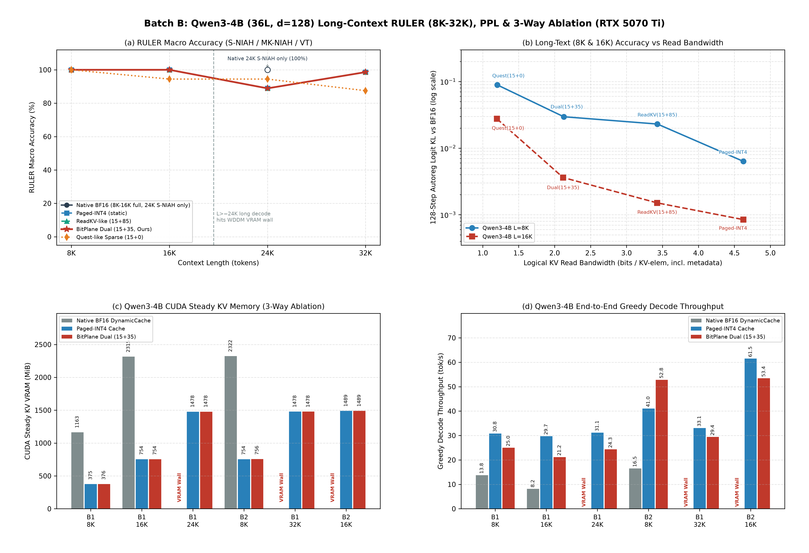

# Bit-Plane Paged Attention (`bitplane-paged-attn`)

**面向 GQA 与 Hybrid Attention 大模型的真物理页池位面渐进式 KV-Cache 解码与双流 Split-KV Triton 算子实现**


---

## 项目核心定位与学术边界说明

传统 KV-Cache 量化方案在写入时即静态锁死比特精度；而在长上下文推理中，不同 Query 对历史上下文页面（Page）的依赖度呈现高度稀疏且动态变化的特征。然而，算法层的理想稀疏率往往在 GPU 上受阻于两大工程瓶颈：**页内高精度分支引发的寄存器膨胀与占用率骤降**，以及 **GQA 多 Query 头独立选页造成的物理访存集合碎片化放大**。

本项目并不将“渐进式高低位面编码与自适应精度读取”单独声明为原创概念，而是明确将其定位为**面向 MLSys 的软硬协同 Paged Attention Backend**：

1. **面向 GQA 的组级共享各向异性页排序启发式（Anisotropic Group-Shared Page Ranking Heuristic）**：将物理页视作多维尺度包围体进行组级统一选页，引入**逐头跨页独立归零**与 GQA 软最大值路由平滑项并配合 Page-0 锚定，通过 4 篇异质长文档 × 全尾窗全局 Softmax **Attention Mass Recall** 与 **Oracle Page Recall** 消融确立其工程有效性边界。
2. **零循环内门控分支的双流 Split-KV 物理调度与真 `PagedKVPool`**：将同一套物理 2+2 位面池彻底拆解为两支无控制流分支的轻量 Triton 算子（Hot 读 4-bit 完整精度、Warm 仅读 2-bit Base 位面、Skip 直接零读），将 `d=128` 算子寄存器压低至 `<= 128`（`4 CTAs/SM`），消除与算子编译期相关的 GPU-CPU 同步障碍；支持乱序 `block_table`、Prefix Caching（引用计数 + 单引用原地覆写自动解绑哈希 + CoW）、完整 `attention_mask` 语义（含 `strict_mask` 校验与 Left-padding 安全回退）及并发安全 `attach()` / 无状态 `activate()`。
3. **端到端真省显存且突破显存墙的 `BitPlaneDynamicCache`**：原生继承 `transformers` `CacheLayerMixin` 与 `Cache` 接口，Prefill 阶段即实时打包落池并释放原始全精度历史缓存，仅保留上限 `recent_tokens + page_size - 1 = 63 tokens`（默认 `recent_tokens=32, page_size=32`）的滑窗全精度 Tail，自动适配 `Qwen3` Dense 与 `Qwen3.5` Hybrid 架构；在 `RTX 5070 Ti (15.89 GB WDDM)` 上将 `Qwen3-4B` KV Cache 压缩 **3.07×–3.16×**，跨过原生 `DynamicCache` 于 `>=24K` 触及的 WDDM 显存墙流畅推演至 **32K**。

### 与相关研究工作的边界对比

| 相关工作 | 核心研究聚焦 | 与本项目的差异及定位界定 |
| :--- | :--- | :--- |
| **KIVI** (ICML 2024) | Key Per-Channel、Value Per-Token 静态低比特量化 | 基础量化直觉相似；本项目进一步解耦存储精度与每次 Decode 的实时读取精度 |
| **Quest** (ICML 2024) | Query 感知的页级稀疏 KV 筛选与全跳过 | 仅做“读/跳过”二元硬决策；本项目增加 **Warm 2-bit Base 位面渐进读取层**与统一 GQA 组内路由 |
| **KVTuner** (ICML 2025) | 层级静态/离线混合精度配比 | 静态按层分配固定位宽；本项目在运行时按 Page × KV-Head 动态分级读写 |
| **PM-KVQ** (ICLR 2026) | 渐进式混合精度 KV 量化编码 | 编码层面思想相关；本项目重在 GPU **双流 Split-KV 算子寄存器控制与真实 Paged 页表访存** |
| **Lynx** (2026.07) | 高低有效位分流与渐进式传输 | 聚焦跨层/传输分级分流；本项目聚焦片上 **GQA 组级共享路由 + Triton 无分支双核执行体系** |
| **ReadKV** (2026.10, `arXiv:2610.11245`) | Query 自适应渐进式 KV 精度读取 | 算法主思路高度重合；因此本项目聚焦 **GQA 共享各向异性排序实证、零分支双流 Split-KV + 乱序页表真内核与 `BitPlaneDynamicCache` 真机显存墙突破系统** |

---

## 核心技术与架构原理

### 1. 存储-读取解耦的嵌套 2+2 位面物理池（Reversible 2+2 Bit-Plane）

物理页池 `PagedBitPlaneKVPool` 对每个满页（`page_size = 32`）按组量化为无符号 4-bit 整数 $q_4 \in \{0, \dots, 15\}$，并将其无损拆分为高 2-bit **Base Plane** ($q_{\text{base}} \in \{0,1,2,3\}$) 与低 2-bit **Residual Plane** ($q_{\text{res}} \in \{0,1,2,3\}$)，每 4 个分量紧密打包成 1 个 `uint8`：

$$q_4 = 4 q_{\text{base}} + q_{\text{res}}, \qquad \hat{x}_4 = m + s (4 q_{\text{base}} + q_{\text{res}}), \qquad \hat{x}_2 = m + s (4 q_{\text{base}} + 1.5)$$

- **可逆的渐进读取与误差界**：当前 Query 对 Warm Page 仅读取高 2-bit `Base Plane` 时，无需回写或重新量化存储；后续 Query 需要高精度时仍可随时访问原址 `Residual Plane`。该粗粒度读取相对于 **INT4 表示** 的最大额外重建误差严格有界：

$$|\hat{x}_4 - \hat{x}_2| \le 1.5 s$$

  *(注：上述“无损”特指位面重组等价于原始 INT4 量化存储，并非相对于原始 BF16/FP16 张量无损。)*

- **Block-First 4D 物理布局 & 工程安全性闭环**：
  - 物理池以 `[num_blocks, num_kv_heads, page_size, head_dim // 4]` 组织，消除连续大张量假设与 `DynamicCache` 每步 `torch.cat` 内存重分配碎片；
  - **Prefix Caching 缓存一致性**：支持 `fork_sequence()` 共享前缀页哈希命中、`ref_count` 引用计数与 **Copy-on-Write (CoW)**；当单引用块 (`ref_counts[blk] <= 1`) 发生原地覆写或释放时，强制调用 `_unbind_prefix_key()` 解除双向哈希绑定，杜绝陈旧哈希命中污染；
  - **Attention Mask 完整语义与零同步热路径**：向 `transformers` 注册 `ALL_MASK_ATTENTION_FUNCTIONS["bitplane_paged"]`；无 Padding 时透传 `None` 维持零 GPU-CPU 同步热路径；存在有效外部遮罩（如 Left-padding Batch）时，`triton_dualstream` 路由自动屏蔽全掩码废弃页并关闭错置 Pin-0 锚定，HF Decode 自动路由至掩码回退路径；`strict_mask=True` 时对非常规 4D 偏置主动报错；
  - **并发安全挂载**：`BitPlaneDynamicCache.attach(model)` 通过全局锁 + 引用计数守护模型共享状态，`activate(model, cache)` 提供无共享写的异步安全 `ContextVar` 上下文隔离。

### 2. GQA 组级共享各向异性页排序启发式（Anisotropic Page Ranking Heuristic）

在 GQA 中，同一 KV Head 服务多个 Query Head（如 `Qwen3` 中 $G=4$），我们对每页构造各向异性中心与半径向量 $c_p = k_{\min} + 7.5 s$、$r_p = 7.5 s$，由单卡 Triton Ranker 核先算逐头分数，再做**逐头跨页独立归零**，消去不同 Query Head 间的绝对分偏置以防止单一高幅值头垄断组内路由：

$$u(q_g, p) = q_g^\top c_p + \beta \sqrt{\sum_{i=1}^{d} q_{g,i}^2 r_{p,i}^2}, \qquad \tilde{u}_{g,p} = u(q_g, p) - \max_{j} u(q_g, j), \qquad S(p) = \max_{g \in G} \tilde{u}_{g,p} + 10^{-5} \sum_{g \in G} \exp(\tilde{u}_{g,p})$$

- **理论诚实性声明**：对于逐维包围盒 $\mathcal{B}_p = \{k : |k_i - c_{p,i}| \le r_{p,i}\}$，严格的线性点积上界应为 $\max_{k \in \mathcal{B}_p} q^\top k = q^\top c_p + \sum_i |q_i| r_{p,i}$（即 `box_l1`）；我们的椭圆式表达 $u(q,p)$ 在通用 $\beta=1.5$ 下**不是数学意义上的最坏盒严格上界**。然而实证表明：$\ell_1$ 盒上界会受维度奇异离群值惩罚而在真实注意权重下大幅劣化排序质量，而各向异性启发式排序能在显著降低奇异维误选率的同时高效召回真实注意力质量。

### 3. 零循环内分支双流 Split-KV 执行引擎（Eliminating Register Spilling）

在单核内使用 `if tier == HOT ... else ...` 门控会迫使编译器拉升活寄存器至 `152 regs/thread`（`3 CTAs/SM`），导致实际推理倒退为负优化。本项目采用三阶段无循环门控执行流水线：

1. `_paged_anisotropic_score_kernel`（`77 regs`, `6 CTAs/SM`）：按物理页表读取尺度矢量，并行产出逐头归零后的组级路由分；
2. 零 `.item()` 同步顶优路由：通过 `UNIFORM_N_SEL` 常量折叠与 host 侧固定元信息，分配 `Hot (top 15%)` 与 `Warm (next 35%)` 物理索引数组，其余页面零物理读取；
3. 两支专注算子 + `_paged_dualstream_agg_and_tail_kernel`：
   - `_paged_indexed_int4_splitkv_kernel`（`128 regs`, `4 CTAs/SM`）仅处理 Hot 页表，完整加载 `Base + Residual` 4-bit 位面；
   - `_paged_indexed_base2_splitkv_kernel`（`127 regs`, `4 CTAs/SM`）仅处理 Warm 页表，**物理层跳过全部 Residual 张量**；
   - 在线 Log-Sum-Exp 融合 `Hot + Warm + Full-Precision Tail`（活跃尾窗长度上限 `recent_tokens + page_size - 1`）。

---

## Batch A / A+ 实测表现（单算子与轻量模型端到端消融）

> 硬件与软件环境：`NVIDIA GeForce RTX 5070 Ti (15.89 GB, 70 SMs, Blackwell sm_120)`、`Python 3.11.9`、`PyTorch 2.9.1+cu128`、`Triton 3.5.1`、`Transformers 5.24.1`。


### 1. 长上下文单算子 Decode 延迟与乱序页表开销（`float16`, `page_size=32`, `Hot 15% + Warm 35%`）

*(注：`cuDNN SDPA` 使用 PyTorch 原生 `enable_gqa=True` 后端直接评测；对于 `d=256`，PyTorch 当前后端 `cuDNN/Flash SDPA` 尚不支持 `head_dim > 128`，故客观标记为 `N/A`。所有 `Paged` 版本均运行在全随机洗牌后的乱序 `block_table` 上。)*

| 规格与批次 | `cuDNN GQA SDPA` (ms) | `Triton-FP16` (ms) | `Triton-INT4` (ms) | `Paged Triton-INT4` (ms) | `SinglePass Gated` (ms) | `DualStream (15+35)` (ms) | `Paged Dual35` (ms, Ours) | 加速 vs `Paged INT4` | 加速 vs `cuDNN SDPA` | 加速 vs `FP16` | 乱序页表开销 |
| :--- | :---: | :---: | :---: | :---: | :---: | :---: | :---: | :---: | :---: | :---: | :---: |
| **`d=128` (`32Q/8KV`), `B=1, L=64K`** | 0.338 | 0.358 | 0.195 | 0.199 | — | 0.165 | **0.182** | **1.10×** | **1.86×** | **1.97×** | +10.1% |
| **`d=128` (`32Q/8KV`), `B=4, L=32K`** | 0.675 | 0.681 | 0.352 | 0.383 | 0.654 | 0.234 | **0.236** | **1.62×** | **2.86×** | **2.89×** | **+0.8%** |
| **`d=128` (`32Q/8KV`), `B=4, L=64K`** | 1.333 | 1.352 | 0.691 | 0.758 | 1.301 | 0.424 | **0.431** | **1.76×** | **3.09×** | **3.13×** | **+1.7%** |
| **`d=256` (`16Q/4KV`), `B=1, L=64K`** | N/A | 0.690 | 0.246 | 0.290 | — | 0.167 | **0.184** | **1.58×** | N/A | **3.75×** | +10.0% |
| **`d=256` (`16Q/4KV`), `B=4, L=32K`** | N/A | 0.684 | 0.388 | 0.392 | 0.566 | 0.246 | **0.256** | **1.53×** | N/A | **2.67×** | +4.3% |
| **`d=256` (`16Q/4KV`), `B=4, L=64K`** | N/A | 1.351 | 0.672 | 0.761 | 1.095 | 0.461 | **0.466** | **1.63×** | N/A | **2.90×** | **+1.1%** |

- **页池静态存储容量压缩**：在 `B=4, L=64K` 下，`d=128` 单层 KV 池由 FP16 等价 **`1024.0 MB` 压缩至 `296.36 MB`（`3.46×`）**；`d=256` 由 `1024.0 MB` 压缩至 **`292.36 MB`（`3.50×`）**。

### 2. PTXAS 硬件编译资源剖析（`B=4, num_warps=4`）

| Kernel 模块 | `d=128` Regs/Thread | `d=128` Shared Mem | `d=128` Max CTAs/SM | `d=256` Regs/Thread | `d=256` Shared Mem | `d=256` Max CTAs/SM |
| :--- | :---: | :---: | :---: | :---: | :---: | :---: |
| `singlepass_gated` (有循环门控) | 152 | 3,584 B | 3 | 235 | 7,168 B | 2 |
| `int4_splitkv` (无分支基准) | 128 | 9,856 B | 4 | 243 | 19,584 B | 2 |
| **`paged_anisotropic_score` (Ranker)** | **77** | **16,384 B** | **6** | **162** | **32,768 B** | **3** |
| **`paged_hot_int4` (物理池 Hot)** | **128** | **5,444 B** | **4** | **244** | **10,820 B** | **2** |
| **`paged_warm_base2` (物理池 Warm)** | **127** | **3,396 B** | **4** | **221** | **6,724 B** | **2** |

### 3. Batch A+ 各向异性页排序启发式实证：多文档 + 全尾窗 Attention Mass Recall 消融

基于 **4 篇异质长文档 × 16 步（共 64 个真实前向 Decode Query）**、`P=63` 历史页 + **完整 Tail 全局 Softmax** 进行评测：

| 模型 (全真实前向抽取) | 指标 (`Tail Mass` 占比) | `center` ($\beta=0$) | `anisotropic` ($\beta=0.5$) | `anisotropic` ($\beta=1.0$) | **`anisotropic` ($\beta=1.5$, 默认)** | `anisotropic` ($\beta=2.0$) | `box_l1` (严格盒边界) |
| :--- | :--- | :---: | :---: | :---: | :---: | :---: | :---: |
| **`Qwen3.5-0.8B`** | 历史页面 `Hist@15%` / `Pin-0` | 57.6% / 57.2% | 58.1% / 57.5% | 58.6% / 57.9% | **58.7% / 58.1%** | 58.8% / 58.0% | 49.0% / 48.4% |
| (`6` 全局层，`Tail = 29.3%`) | 含尾窗全注意力 `Full@15%` / `Full@50%` | 70.5% / 92.5% | 70.8% / 92.7% | 71.1% / 92.9% | **71.2% / 92.9%** | 71.3% / 92.9% | 64.1% / 89.2% |
| | `Oracle Top-15% Page Recall` | 63.9% | 64.8% | 65.4% | **65.5%** | 65.4% | 48.4% |
| **`Qwen3-0.6B`** | 历史页面 `Hist@15%` / `Pin-0` | 71.3% / 80.4% | 76.6% / 80.5% | 79.2% / 80.4% | **79.8% / 80.2%** | 79.6% / 79.8% | 74.5% / 75.9% |
| (`28` 全局层，`Tail = 33.2%`) | 含尾窗全注意力 `Full@15%` / `Full@50%` | 82.1% / 95.7% | 85.7% / 96.6% | 87.4% / 96.7% | **87.8% / 96.6%** | 87.7% / 96.5% | 84.6% / 95.1% |
| | `Oracle Top-15% Page Recall` | 68.7% | 69.6% | 69.6% | **68.5%** | 66.9% | 52.9% |

> **关键发现**：引入各向异性方差项 ($\beta=1.5$) 相比单纯中心点积 ($\beta=0$) 在 `Qwen3-0.6B` 历史页召回上提升 **`+8.5%`**（`71.3% -> 79.8%`），而严格 $\ell_1$ 包围盒上界 (`box_l1`) 因极端维度奇异值扰动导致 `Oracle Top-15%` 急剧跌至 **`48.4% / 52.9%`**，直接印证了各向异性启发式排序的实证优越性。

### 4. Batch A+ 真实模型精度与统一单标量读带宽（`BF16` 参考，4 篇异质文档语料）

> **指标声明**：**逻辑 KV 读流量（`bits / KV-elem`）** 由 `compute_logical_read_bits_per_kv_elem()` 统计，将已访问页的 `Base`/`Residual` 负载连同 `min`/`scale` 参数与页评分元数据合并折算为单个标量；该指标反映算法层读取密度，并非 `ncu` 硬件 DRAM 计数器字节数。

| 模型 (`BF16` 参考 PPL) | 策略配置 | 逻辑 KV 读流量 (`bits / KV-elem`) | PPL (Δ vs `BF16`) | 平均 Logit KL | Passkey (5/5) |
| :--- | :--- | :---: | :---: | :---: | :---: |
| **`Qwen3.5-0.8B`** | `Paged Triton-INT4` | 4.56 | 21.455 (-0.243) | 0.00824 | 5 / 5 |
| (Hybrid 18 线性 + 6 全局) | `DualStream (15+85)` | 3.37 | 21.798 (+0.100) | 0.04713 | 5 / 5 |
| `BF16 PPL = 21.6981` | **`DualStream (15+35)` (推荐)** | **2.13** | **22.038 (+0.339)** | **0.05304** | **5 / 5** |
| | `DualStream (15+0)` (极稀疏对照) | 1.21 | 22.693 (+0.995) | 0.10776 | 5 / 5 |
| **`Qwen3-0.6B`** | `Paged Triton-INT4` | 4.62 | 16.228 (-0.063) | 0.00717 | 5 / 5 |
| (Dense 28 全局层) | `DualStream (15+85)` | 3.44 | 16.697 (+0.406) | 0.01595 | 5 / 5 |
| `BF16 PPL = 16.2909` | **`DualStream (15+35)` (推荐)** | **2.16** | **16.580 (+0.289)** | **0.01684** | **5 / 5** |
| | `DualStream (15+0)` (极稀疏对照) | 1.22 | 18.176 (+1.885) | 0.06094 | 5 / 5 |

### 5. Batch A+ 三方端到端显存、`End-to-End Greedy Decode` 与 `model.generate()` 对照消融

| 模型与结构 | 负载规格 | `Native BF16` 显存 / Greedy 吞吐 | `Paged-INT4` 显存 / 吞吐 (vs BF16) | **`BitPlane Dual (15+35)` 显存 / 吞吐 (vs BF16 / vs INT4)** | 真实 CUDA KV 压缩比 (池压缩) | `model.generate()` 全流程 Wall-Clock (`B4, L4096`) |
| :--- | :--- | :---: | :---: | :---: | :---: | :--- |
| **`Qwen3-0.6B`** | `B4, L2048, gen=128` | 953.2 MB / 103.2 tok/s | 309.1 MB / 104.8 tok/s (1.02×) | **309.1 MB / 116.6 tok/s (1.13× / 1.11×)** | **3.08×** (`3.34×`) | — |
| (Dense 28 全局层) | `B4, L4096, gen=128` | 1849.3 MB / 39.9 tok/s | 606.5 MB / 105.5 tok/s (2.65×) | **606.5 MB / 103.6 tok/s (2.60× / 0.98×)** | **3.05×** (`3.40×`) | BF16: `15.27s (33.5 tok/s)` \| INT4: `9.06s (56.5 tok/s)` \| **Dual35: `8.11s (63.1 tok/s)`** |
| | `B1, L8192, gen=64` | 903.3 MB / 26.1 tok/s | 298.2 MB / 36.8 tok/s (1.41×) | **298.2 MB / 28.9 tok/s (1.11× / 0.79×)** | **3.03×** (`3.43×`) | — |
| **`Qwen3.5-0.8B`** | `B4, L2048, gen=128` | 188.9 MB / 154.8 tok/s | 138.5 MB / 141.1 tok/s (0.91×) | 138.5 MB / 131.0 tok/s (0.85× / 0.93×) | **1.36×** (`3.38×`) | — |
| (Hybrid 18 线性 + 6 全局) | `B4, L4096, gen=128` | 283.6 MB / 141.5 tok/s | 146.8 MB / 139.5 tok/s (0.99×) | 146.8 MB / 106.1 tok/s (0.75× / 0.76×) | **1.93×** (`3.44×`) | BF16: `5.77s (88.7 tok/s)` \| INT4: `5.33s (96.1 tok/s)` \| **Dual35: `5.23s (97.9 tok/s)`** |
| | `B1, L8192, gen=64` | 116.6 MB / 38.6 tok/s | 71.5 MB / 28.1 tok/s (0.73×) | 71.5 MB / 31.3 tok/s (0.81× / 1.11×) | **1.63×** (`3.47×`) | — |

> **贡献拆分与边界分析**：三方消融清楚表明，显存压缩 (`3.03×–3.08×` 于 0.6B、`1.36×–1.93×` 于 0.8B Hybrid) 主要来自 **Paged 2+2 INT4 物理存储**；而在 `Qwen3-0.6B B4, L4096` 带宽受限场景下，`Paged-INT4` 已提供 `2.65×` Greedy 加速（`39.9 -> 105.5 tok/s`），`Dual35` 在同等总带宽下进一步在真实 `model.generate()` 端到端链路中跑出 **`63.1 tok/s`**（相对原生 `1.88×`、相对 INT4 `1.12×`）。反之在 `Qwen3.5-0.8B` 等轻量 Hybrid 模型上，因仅含 6 个全局层且受 18 个线性状态层及小模型 Python 调度固定开销主导，使用压缩内核会呈现负收益（`0.75×–0.85×`），符合预期适用边界。

---

## Batch B：`Qwen3-4B` (8K–32K) 长上下文多任务评测与 WDDM 显存墙突破

为验证高参数量真实模型在超长上下文中的精度稳定性与系统可行性，本项目在 `Qwen3-4B`（36 层全 GQA `32Q/8KV, d=128, BF16`, 模型静态权重 ~7.5 GB）上构建了 **8K / 16K / 24K / 32K RULER 三任务评测**、**128 步自回归长文本 PPL/KL** 以及 **6 档三方显存吞吐消融**。

> **WDDM 显存墙（Windows Single-Process VRAM Ceiling）说明**：`RTX 5070 Ti (15.89 GB)` 在 Windows WDDM 下扣除桌面环境与运行框架开销后，单进程可用物理专用显存上限约 ~14.0 GB。`Native BF16 DynamicCache` 因 36 层每步 Decode 执行全量 `torch.cat` 拷贝扩容，总 KV token 达到 `>=24K` 且连续生成 `48–128` 步时，累计占用瞬间越过 ~14.0 GB 触发系统内存换页悬崖；而 `Paged-INT4` 与 `BitPlane Dual` 凭借预分配固定物理页池与零拷贝碎片消除，在 **32K / B2×16K** 负载下净 KV 稳态仅约 **1.45 GB**（总显存 ~9.0 GB），从而顺利完成全套 32K 任务。



### 1. RULER 长上下文检索与多跳变量追踪（`8K–32K` 五方对比）

| 任务与上下文长度 | `Native BF16` | `Paged-INT4` (`4.62b`) | `ReadKV-like (15+85)` (`~3.43b`) | **`BitPlane Dual (15+35)` (`~2.12b`, Ours)** | `Quest-like Sparse (15+0)` (`~1.20b`) |
| :--- | :---: | :---: | :---: | :---: | :---: |
| **`S-NIAH` @ 8K / 16K / 24K** (`10 depths/L`) | 100.0% / 100.0% / 100.0% | 100.0% / 100.0% / 100.0% | 100.0% / 100.0% / 100.0% | **100.0% / 100.0% / 100.0%** | 100.0% / 100.0% / 100.0% |
| **`S-NIAH` @ 32K** (`10 depths`) | *WDDM VRAM Wall* | 100.0% (10/10) | 100.0% (10/10) | **100.0% (10/10)** | 100.0% (10/10) |
| **`MK-NIAH` @ 16K** (`24 keys, 4/case`) | 100.0% (exact4=100%) | 100.0% (exact4=100%) | 100.0% (exact4=100%) | **100.0% (exact4=100%)** | 100.0% (exact4=100%) |
| **`MK-NIAH` @ 24K** (`24 keys, 4/case`) | *WDDM VRAM Wall* | 100.0% (exact4=100%) | 100.0% (exact4=100%) | **100.0% (exact4=100%)** | 100.0% (exact4=100%) |
| **`MK-NIAH` @ 32K** (`24 keys, 4/case`) | *WDDM VRAM Wall* | 95.8% (exact4=83.3%) | 95.8% (exact4=83.3%) | **95.8% (exact4=83.3%)** | 95.8% (exact4=83.3%) |
| **`VT` @ 8K** (`6 cases`) | 100.0% (6/6) | 100.0% (6/6) | 100.0% (6/6) | **100.0% (6/6)** | 100.0% (6/6) |
| **`VT` @ 16K** (`6 cases`) | 100.0% (6/6) | 100.0% (6/6) | 100.0% (6/6) | **100.0% (6/6)** | **83.3% (5/6)** |
| **`VT` @ 24K** (`6 cases`) | *WDDM VRAM Wall* | 66.7% (4/6) | 66.7% (4/6) | 66.7% (4/6) | 83.3% (5/6) |
| **`VT` @ 32K** (`6 cases`) | *WDDM VRAM Wall* | 100.0% (6/6) | 100.0% (6/6) | **100.0% (6/6)** | **66.7% (4/6)** |

> **精度保真解读**：在需要跨页连续多跳引用的 `Variable Tracking (VT)` 任务上，硬截断对照 `Quest-like (15+0)` 在 **16K 退化至 `83.3%`**、在 **32K 进一步掉至 `66.7%`**；而 **`BitPlane Dual (15+35)`** 借助 35% Warm 2-bit Base 位面兜底长尾关联，在 `8K / 16K / 32K VT` 全保持 **`100.0%`**，并在 `32K MK-NIAH` 上实现相对全读 `Paged-INT4` 的 **`95.8%` 零退化等效**（`24K VT` 下 `Dual35`、`ReadKV` 与全读 `Paged-INT4` 同为 `4/6`，反映该随机干草堆位置下的 4-bit 基础量化的样本敏感性）。

### 2. 长文本 128 步自回归 PPL / Logit KL（`8K / 16K / 24K / 32K`）

| 上下文长度 (`BF16` 基准或参照声明) | `Paged-INT4` (`4.62b`) | `ReadKV-like (15+85)` (`~3.43b`) | **`BitPlane Dual (15+35)` (`~2.12b`, Ours)** | `Quest-like (15+0)` (`~1.20b`) |
| :--- | :---: | :---: | :---: | :---: |
| **`8K`** (`Native BF16 PPL = 3.7379`) | 3.7668 (`KL=0.00633`) | 3.6927 (`KL=0.02300`) | **3.7539 (`+0.0160`, `KL=0.02962`)** | 4.0167 (`+0.2788`, `KL=0.08897`, **3.0× KL**) |
| **`16K`** (`Native BF16 PPL = 1.1969`) | 1.1900 (`KL=0.00084`) | 1.2035 (`KL=0.00151`) | **1.2114 (`+0.0145`, `KL=0.00362`)** | 1.2634 (`+0.0665`, `KL=0.02756`, **7.6× KL**) |
| **`24K`** (*BF16 WDDM Wall*, 对比 `INT4=1.2531`) | 1.2531 (`ref`) | 1.2471 (`KL=0.00082`) | **1.2449 (`KL=0.00096`)** | 1.2428 (`KL=0.00388`, 4.0× KL) |
| **`32K`** (*BF16 WDDM Wall*, 对比 `INT4=2.3585`) | 2.3585 (`ref`) | 2.3627 (`KL=0.00298`) | **2.3757 (`KL=0.00555`)** | 2.3888 (`KL=0.01297`, 2.3× KL) |

### 3. `Qwen3-4B` 6 档三方显存与 End-to-End Greedy Decode 吞吐消融

| 负载规格 | `Native BF16` 显存 / 吞吐 | `Paged-INT4` 显存 / 吞吐 (vs BF16) | **`BitPlane Dual (15+35)` 显存 / 吞吐 (vs BF16 / vs INT4)** | 真实 CUDA KV 压缩比 (池压缩) |
| :--- | :---: | :---: | :---: | :---: |
| **`B=1, L=8192, gen=64`** | 1163.0 MB / 13.8 tok/s | 375.0 MB / 30.8 tok/s (2.23×) | **376.3 MB / 25.0 tok/s** (1.81× / 0.81×) | **3.09×** (`3.43×`) |
| **`B=1, L=16384, gen=64`** | 2315.0 MB / 8.2 tok/s | 754.0 MB / 29.7 tok/s (3.64×) | **754.0 MB / 21.2 tok/s** (2.59× / 0.71×) | **3.07×** (`3.44×`) |
| **`B=2, L=8192, gen=64`** | 2322.0 MB / 16.5 tok/s | 754.5 MB / 41.0 tok/s (2.48×) | **756.4 MB / 52.8 tok/s** (**3.19× / 1.29×**) | **3.07×** (`3.43×`) |
| **`B=1, L=24576, gen=64`** | *WDDM VRAM Wall* | 1477.8 MB / 31.1 tok/s | **1477.8 MB / 24.3 tok/s** (— / 0.78×) | 池 **`3.45×`** (FP16 等价 3465 MB) |
| **`B=1, L=32768, gen=64`** | *WDDM VRAM Wall* | 1477.8 MB / 33.1 tok/s | **1477.8 MB / 29.4 tok/s** (— / 0.89×) | 池 **`3.45×`** (FP16 等价 4617 MB) |
| **`B=2, L=16384, gen=64`** | *WDDM VRAM Wall* | 1488.8 MB / 61.5 tok/s | **1488.8 MB / 53.4 tok/s** (— / 0.87×) | 池 **`3.44×`** (FP16 等价 4626 MB) |

> **4B 性能剖析**：
> 1. 在 `B=2, L=8192` 下，`BitPlane Dual (15+35)` 凭借 KV 读取减半成功覆盖路由器 launch 成本，端到端 Greedy 吞吐反超 `Paged-INT4` 达 **`1.29×`**（`52.8 vs 41.0 tok/s`），相对 `Native BF16` 加速 **`3.19×`**。
> 2. 在 `B=1` 场景下，虽然 `Dual35` 随上下文从 8K 升至 32K 与 `Paged-INT4` 的比值由 `0.71×–0.81×` 收敛至 `0.89×`，但受 `Qwen3-4B` 每层仅 `8` 个 KV Head 且 36 层 MLP 权重访存 (~7.5 GB) 占主导影响，单批下多阶段 Ranker + Split-KV 的 4 次 Python/Kernel 启动固定开销仍略高于单一静态 `Paged-INT4` 内核；将路由融合为单一持久化核以彻底抹除 `B=1` launch 成本是下一步工程优化的明确方向。

---

## 快速上手（Quick Start）

### 环境安装

```bash
git clone https://github.com/6Riemann9/bitplane-paged-attn.git
cd bitplane-paged-attn
pip install -e .[dev]
```

> 若从本地离线缓存目录加载 `Qwen3-0.6B` / `Qwen3.5-0.8B` / `Qwen3-4B` 权重，可设置环境变量 `BITPLANE_MODEL_CACHE=/path/to/model_cache`；未设置时测试与基准会自动回退至 Hugging Face Hub 下载/读取缓存。

### 验证与一键复现实验

```bash
# 1. 运行全量单元测试（覆盖数学等价性、CoW单引用哈希解绑、Mask语义、并发安全attach/activate、HF Cache 与真模型自回归）
pytest tests -v

# 2. GPU 与 Triton 编译冒烟验证
python scripts/smoke_triton_gpu.py

# 3. 完整执行 Batch A+ 五大实测模块并重绘图表（支持 --only-recall-and-e2e 与 --plot-only）
python scripts/benchmark_triton_gpu.py

# 4. 执行 Batch B Qwen3-4B (8K-32K) RULER + Long-PPL + 4B 三方消融（支持 --resume 断点续跑与 --plot-only）
python scripts/benchmark_long_context_4b.py
```

### API 使用示例

#### 方式一：直接对接 Hugging Face `transformers` 模型推理

```python
import torch
from transformers import AutoModelForCausalLM, AutoTokenizer
from bitplane_attn import BitPlaneDynamicCache

model_id = "Qwen/Qwen3-0.6B"
tokenizer = AutoTokenizer.from_pretrained(model_id)
model = AutoModelForCausalLM.from_pretrained(model_id, dtype=torch.bfloat16, device_map="cuda").eval()

inputs = tokenizer("Explain why GQA benefits from shared page routing:", return_tensors="pt").to("cuda")

# 实例化 BitPlaneDynamicCache（Prefill 阶段即自动压缩满页历史并释放原始大张量）
past_key_values = BitPlaneDynamicCache(
    config=model.config,
    page_size=32,
    recent_tokens=32,
    mode="triton_dualstream",
    hot_ratio=0.15,
    warm_ratio=0.35,
    beta=1.5,
    strict_mask=True,  # 若传入非常规自定义 4D Mask，显式抛出异常而非静默忽略
)

# 常规单流用法：attach(model) 带锁与引用计数接管并自动无痕还原
with torch.no_grad(), past_key_values.attach(model):
    out_ids = model.generate(**inputs, max_new_tokens=64, past_key_values=past_key_values, do_sample=False)

# 并发服务推荐用法：一次性注册静态补丁后，通过无共享状态变更的 ContextVar 上下文激活各请求独立 Cache
# with torch.no_grad(), BitPlaneDynamicCache.activate(model, past_key_values):
#     ...

print(tokenizer.decode(out_ids[0], skip_special_tokens=True))
print("物理池统计:", past_key_values.memory_stats())
```

#### 方式二：底层物理页池与 Triton 双流算子调用

```python
import math
import torch
from bitplane_attn import PagedBitPlaneKVPool, triton_paged_bitplane_dualstream_decode

B, H_q, H_kv, L, D = 2, 32, 8, 4096, 128
pool = PagedBitPlaneKVPool(num_kv_heads=H_kv, head_dim=D, page_size=32, capacity=512, kv_dtype=torch.float16, device="cuda")

seq_ids = [pool.allocate_sequence(101), pool.allocate_sequence(102)]
for sid in seq_ids:
    k_init = torch.randn(1, H_kv, L, D, device="cuda", dtype=torch.float16)
    v_init = torch.randn(1, H_kv, L, D, device="cuda", dtype=torch.float16)
    pool.append_kv(sid, k_init, v_init)

# 构建零同步乱序物理页表批次并执行 Decode
batch = pool.build_batch(seq_ids)
q = torch.randn(B, H_q, 1, D, device="cuda", dtype=torch.float16)
attn_out = triton_paged_bitplane_dualstream_decode(
    q,
    batch,
    scaling=1.0 / math.sqrt(D),
    hot_ratio=0.15,
    warm_ratio=0.35,
    beta=1.5,
)
print(attn_out.shape, pool.memory_stats())
```

---

## 仓库目录结构

```text
bitplane-paged-attn/
├── pyproject.toml                       # 包配置（Python >=3.11，PyTorch/Transformers/Triton 依赖与 pytest 路径）
├── LICENSE                              # MIT License
├── README.md                            # 项目技术说明、Batch A+/B 实测报告与快速上手指南
├── src/bitplane_attn/
│   ├── __init__.py                      # 对外统一导出公开类与核函数入口
│   ├── quant_bitplane.py                # 可逆 2+2 位面编码/解码参考实现、逐头归零各向异性路由、Mask 屏蔽与逻辑读流量计算
│   ├── packed_cache.py                  # Block-First 4D PagedBitPlaneKVPool、PagedKVBatch、Prefix Caching/哈希解绑/CoW
│   ├── triton_kernels.py                # Ranker / 双流 Split-KV (Hot INT4 + Warm Base2) / 乱序页表 Triton JIT 核群
│   └── hf_cache.py                      # 原生适配 transformers Cache 接口的 BitPlaneDynamicCache（含 strict_mask 与 activate）
├── tests/
│   ├── test_bitplane_math.py            # 位面量化界、逻辑读流量公式及对齐一致性测试
│   ├── test_triton_kernels.py           # 单流、门控、双流及 FP16/INT4 Triton 核全精度数值验证
│   └── test_paged_and_hf_cache.py       # 乱序页表、单引用哈希解绑、Left-padding Mask、Chunked Prefill 与并发安全性校验
├── scripts/
│   ├── smoke_triton_gpu.py              # CUDA/Triton/Sm120 编译与分词器加载冒烟脚本
│   ├── benchmark_triton_gpu.py          # Batch A+ 延迟/PTXAS/多文档全Tail Recall/三方 E2E VRAM 与 generate() 基准脚本
│   ├── benchmark_long_context_4b.py     # Batch B Qwen3-4B (8K-32K) RULER / Long-PPL / 4B 三方消融（支持 --resume / --plot-only）
│   ├── verify_gated_thresholds.py       # SinglePass 门控阈值扫描辅助脚本
│   └── kill_test_bitplane.py            # 前期路由消融原型对比脚本
└── results/
    ├── triton_benchmark.json            # Batch A+ 全真实测原始数据（含 PTXAS、多文档 Recall、三方 E2E 与 generate()）
    ├── triton_benchmark.png             # Batch A+ 300 DPI 四宫格基准对比图
    ├── long_context_4b.json             # Batch B Qwen3-4B (8K-32K) RULER / PPL / 4B 三方消融原始数据
    ├── long_context_4b.png              # Batch B 300 DPI 四宫格长上下文实测总结图
    ├── gated_threshold_sweep.json       # 单流门控阈值敏感度存档
    ├── kill_test_bitplane.json          # 原型对比存档
    └── kill_test_bitplane.png           # 原型消融存档
```

---

## 已知局限与后续工作

虽然本轮已完成 `Qwen3-4B` 在 `8K–32K` 长上下文下的 RULER / 自回归 PPL 与三方真显存消融，以及 P0/P1 后端工程安全闭环，仍诚实保留以下待探索差距：

1. **更大模型参数规模与百级标准长上下文数据集评估**：目前实测已覆盖 `0.6B / 0.8B / 4B`（高达 32K），后续在多卡或 `>=48GB` 数据中心卡上扩展至 `8B / 14B / 32B`（无 WDDM 限制）及完整 **1000+ 样本 RULER / LongBench v2** 统计基准。
2. **Router 内核融合以降低 `B=1` Launch 固定开销**：当前 `B=1` 场景（尤其是小 KV Head 数模型上）受限于 Ranker、Top-K 挑选与双流 Split-KV 多次 Python 核启动开销，吞吐略逊于单核静态 `Paged-INT4`；后续拟通过 CUDA Graphs 或融合式持久化 Router 降低调度延迟。
3. **Nsight Compute (`ncu`) 硬件 DRAM 事务剖析**：目前逻辑 KV 读流量采用单标量解析公式 `logical_read_bits_per_kv_elem`，后续将在无限制硬件权限环境下补齐 `dram__bytes_read.sum`、`lts__t_sectors_op_read` 与 Warp Stalls 实测。
4. **生产级异步多租户调度引擎对接**：`PagedBitPlaneKVPool` 已提供连续批处理、Prefix Caching、CoW 及无状态 `activate()` 底层能力，尚待与 vLLM / SGLang 风格的异步请求调度循环及连续多并发压测（TTFT / TPOT 尾延迟）集成。
