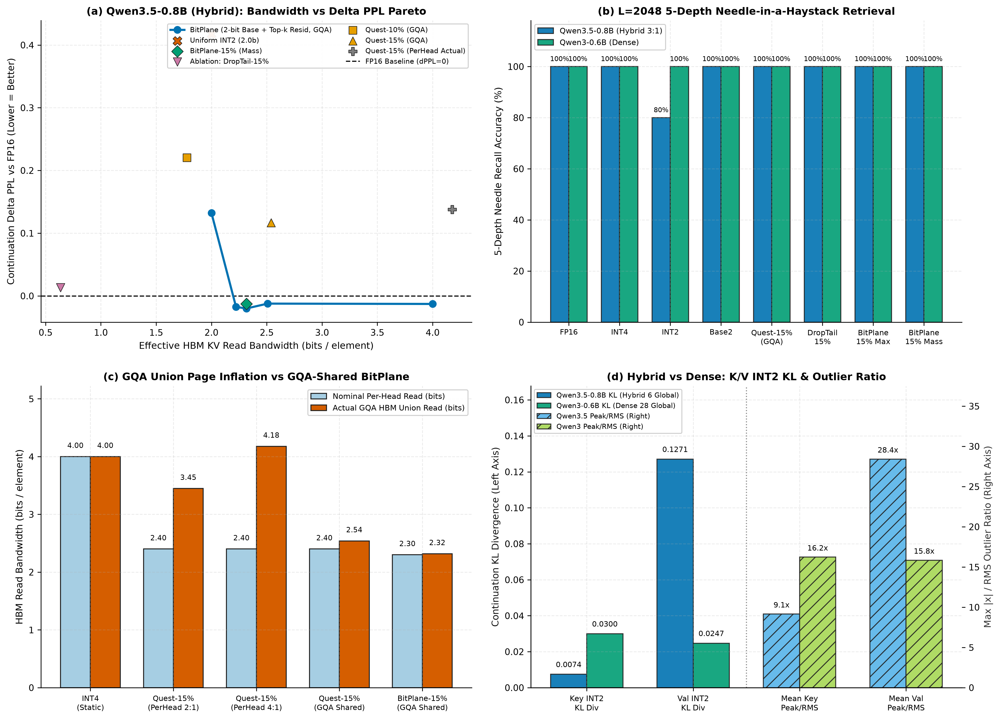

# Bit-Plane Paged Attention

面向混合架构（Hybrid，`Qwen3.5` 等）稀缺全局注意力层与稠密 `GQA` 模型（`Qwen3` / `Llama-3`）的**零驱逐、兼容 `PagedAttention` 与 `Prefix Caching` 的嵌套双位面页级 KV-Cache 解码与无分支双流 `Triton` GPU 算子库**。

[](pyproject.toml)
[-green.svg)](src/bitplane_attn/triton_kernels.py)
[](tests/)
[](LICENSE)

---

## 一、研究动机与核心发现

现代长上下文生产架构正在迅速向 **Hybrid 混合线性/全局注意力**（如 `Qwen3.5`：3:1 比例混合 `GatedDeltaNet` 与稀缺全局 Softmax 层）与高分组倍率 **GQA** 演进。我们在真实模型上的机制剖析发现了两个针对常规低比特/稀疏压缩方法的关键失效现象：

1. **稀缺全局层的 Value 强离群瓶颈（`Qwen3.5-0.8B` 实测）**：在 `Qwen3.5` 的全局注意力层中，Value 峰值离群比最高达 **`54.0× Peak/RMS`**（均值 `28.4×`）。当把整页直接压成独立 `Uniform INT2` 时，KL 散度恶化至 **`0.17441`**（`val_only_int2` 造成的 KL 破坏是 `key_only_int2` 的 **`17.1×`**），5 深度大海捞针命中率跌至 **`4/5`**。
2. **GQA 独立选页的并集带宽膨胀**：像 `Quest` 一类逐头独立选页的方法在 `4:1 GQA` 下因同组不同 Query 头选中不同 KV 页，导致 KV 读取并集产生 **`1.64×`** 膨胀（名义 `15%` 稀疏度下全精读取实效带宽达 **`4.18 bits/elem`**，KL 仍为 `0.06184`）。



---

## 二、核心架构与系统设计

为同时兼顾 **零驱逐精度、显存压缩、GQA 零膨胀、以及真实 GPU 解码加速**，本仓库实现了一套完整的算法–算子协同体系：

1. **硬件原生 4-to-1 Zero-Shuffle 象限打包（[packed_cache.py](src/bitplane_attn/packed_cache.py)）**
   - 沿用页对齐 KIVI 分组粒度（`page_size=32`，Key 页内 per-channel，Value per-token）。
   - 将 4-bit 量化网格拆分为 **2-bit Base**（高两位，带 $+1.5\,\text{scale}$ 无偏中心补偿）与 **2-bit Residual**（低两位）两个嵌套位面，两者叠加在数学上严格无损还原精确 `INT4`。
   - 将头维 $d$ 等分为 4 个连续子象限，在同偏移位置把 4 个 2-bit 整数紧缩装入 1 个 `uint8` 字节，GPU 核内 4 次 `tl.load` 均保持 100% 合并连续访存。

2. **零额外元数据椭球统计路由（`_ellipsoid_score_kernel` & `_dualstream_agg_and_tail_kernel`）**
   - 不增加任何额外索引字节，直接复用页表已存的 `(k_min, k_scale)` 构造页中心 $k_{\text{mid}} = k_{\min} + 7.5\,k_{\text{scale}}$ 与各向异性半径 $r = 7.5\,k_{\text{scale}}$，在 GQA 组内共享计算出 $\hat{m}_{h,p} = \mu_{h,p} + \beta\sigma_{h,p}$（默认 $\beta=1.5$），强制固定 Page 0 (Attention Sink) 并划出三路：
     - **Hot（15%）**：读取完整 4-bit 嵌套位面精修（`9.25b`）；
     - **Warm（35%）**：仅读取 2-bit Base 位面兜底长尾上下文质量（`5.25b`）；
     - **Skip（50%）**：直接跳过，零 KV Payload 读取。

3. **PTXAS 去分支双流 `Triton` 核 + Wave-Aligned 调度（[triton_kernels.py](src/bitplane_attn/triton_kernels.py)）**
   - **`PTXAS` 硬件根因定位**：单循环内部 `if/else` 门控核（`singlepass_gated`）在 `d=128` 下把每线程寄存器撑爆至 **`152 regs`**（每 SM 驻留从 `4 CTAs` 跌至 `3 CTAs`，Occupancy 降 25%）且破坏流水线预取（`shared=3584 B`），实机反而慢于无分支 `Triton-INT4`。
   - **去分支双流核**：按紧凑互斥索引切片 `hot_idx` / `warm_idx` 分别送入 100% 无循环内分支的 `_indexed_int4_splitkv_kernel`（`128 regs`）与 `_indexed_base2_splitkv_kernel`（`127 regs`），恢复满 `4 CTAs/SM` 并发并通过统一 Split-KV Reduce 合并 `Hot + Warm + 全精尾部`。
   - **Wave Quantization 尾波消除（`_choose_dual_splits`）**：依据设备 SM 数与 CTA/SM 上限将分片数按波次容量向下整除，消除溢出尾波（如 `288 > 280` 空转波次）带来的 ~30% 延迟浪费。


---

## 三、RTX 5070 Ti 真机实测数据

测试硬件：`NVIDIA GeForce RTX 5070 Ti`（Blackwell `sm_120`, 70 SMs, `15.89 GB VRAM`, PyTorch `2.9.1+cu128`, Triton `3.5.1`），原始数据全量留存于 [results/triton_benchmark.json](results/triton_benchmark.json) 与 [results/kill_test_bitplane.json](results/kill_test_bitplane.json)。

### 1. 长上下文高并发解码延时与显存压缩（`B=4, float16`）

| 规格与序列长度 $L$ | `PyTorch SDPA` | `Triton-FP16` | `Triton-INT4` | `SinglePass Gated` (分支消融) | **`DualStream 15+35` (Ours)** | vs `Triton-INT4` | vs `Triton-FP16` | vs `SDPA` |
| :--- | :---: | :---: | :---: | :---: | :---: | :---: | :---: | :---: |
| `Qwen3 / Llama-3 (d=128)` **32K** | `8.296 ms` | `0.669 ms` | `0.348 ms` | `0.641 ms` | **`0.230 ms`** | **`1.51×`** | **`2.91×`** | **`36.0×`** |
| `Qwen3 / Llama-3 (d=128)` **64K** | `15.948 ms` | `1.317 ms` | `0.662 ms` | `1.275 ms` | **`0.433 ms`** | **`1.53×`** | **`3.04×`** | **`36.8×`** |
| `Qwen3.5 Global (d=256)` **32K** | `6.851 ms` | `0.708 ms` | `0.361 ms` | `0.578 ms` | **`0.250 ms`** | **`1.44×`** | **`2.83×`** | **`27.4×`** |
| `Qwen3.5 Global (d=256)` **64K** | `17.619 ms` | `1.376 ms` | `0.680 ms` | `1.111 ms` | **`0.462 ms`** | **`1.47×`** | **`2.98×`** | **`38.1×`** |

- **物理显存压缩比（含页元数据与尾部全精，`L=65536, B=4`）**：`d=128` 实占 `296.36 MB` vs `FP16 1024.0 MB`（**`3.46×` 压缩**，`4.63 bits/elem`）；`d=256` 实占 `292.36 MB` vs `FP16 1024.0 MB`（**`3.50×` 压缩**，`4.57 bits/elem`）。
- **适用边界**：单并发超长上下文（`B=1, L=65536`）下，`DualStream (15+35)` 延迟为 `0.163 ms`（`1.12× vs INT4`, `d=128`）与 `0.174 ms`（`1.14× vs INT4`, `d=256`）；而在 `L <= 8192` 或低并发短序列区间，路由与双流调度存在约 `~0.16 ms` 固定 launch 开销，单 Pass `Triton-INT4`（`~0.086–0.098 ms`）更快。

### 2. 真实大模型挂载真实 `Triton` 算子精度（`L=2048`，128 步自回归 + 5 深度找针）

| 模型与架构 | 解码方法（物理读带宽） | 续写 PPL ($\Delta\text{PPL}$) | vs `FP16` KL 散度 | 5 深度大海捞针 |
| :--- | :--- | :---: | :---: | :---: |
| **`Qwen3.5-0.8B`** (Hybrid 3:1)<br>`FP16 Autoreg PPL = 2.0345` | `triton_int4` (`9.25b`) | `2.023 (-0.011)` | `0.00215` | `5/5` |
| | `triton_dualstream_15_85` (`6.88b`) | `2.019 (-0.015)` | `0.01182` | `5/5` |
| | **`triton_dualstream_15_35` (`4.38b`, Ours)** | **`2.011 (-0.024)`** | **`0.01394`** | **`5/5 (100%)`** |
| | `triton_dualstream_15_0` (`2.47b`, 无 Warm 消融) | `2.081 (+0.047)` | `0.04418` | `5/5` |
| **`Qwen3-0.6B`** (Dense 2:1 GQA)<br>`FP16 Autoreg PPL = 2.4540` | `triton_int4` (`9.25b`) | `2.459 (+0.005)` | `0.00223` | `5/5` |
| | `triton_dualstream_15_85` (`6.88b`) | `2.559 (+0.105)` | `0.00941` | `5/5` |
| | **`triton_dualstream_15_35` (`4.38b`, Ours)** | `2.580 (+0.125)` | **`0.01123`** | **`5/5 (100%)`** |
| | `triton_dualstream_15_0` (`2.47b`, 无 Warm 消融) | `2.769 (+0.315)` | `0.04869` | `5/5` |

---

## 四、仓库结构

```text
bitplane-paged-attn/
├── LICENSE
├── pyproject.toml
├── README.md
├── src/bitplane_attn/
│   ├── __init__.py               # 公开接口导出
│   ├── packed_cache.py           # 零洗牌 4 象限 4-to-1 uint8 紧缩物理缓存与显存统计
│   ├── quant_bitplane.py         # 嵌套双位面数学参考算子（含 bitplane / gated / dualstream / quest）
│   └── triton_kernels.py         # FP16 / INT4 / TwoPass / SinglePass-Gated / Zero-Branch DualStream Triton 核
├── tests/
│   ├── test_bitplane_math.py     # 位面无损恒等、因果防泄密、GQA 零膨胀单测
│   └── test_triton_kernels.py    # 打包解包与全部 Triton 核全头维/GQA/边界精度单元校验（82 项）
├── scripts/
│   ├── smoke_triton_gpu.py       # GPU + Triton 编译与分词器冒烟验证
│   ├── kill_test_bitplane.py     # Phase 0 双模型机制诊断与对比基准
│   ├── verify_gated_thresholds.py# Single-Pass 锚点门控阈值真实模型扫描
│   └── benchmark_triton_gpu.py   # RTX 5070 Ti 延时/显存基准、PTXAS 剖析、双模型真核挂接与出图
└── results/
    ├── kill_test_bitplane.json / .png
    ├── gated_threshold_sweep.json
    └── triton_benchmark.json / .png
```

---

## 五、快速安装与复现

### 1. 安装依赖（Linux/Windows CUDA GPU + Triton）

```bash
pip install -e ".[dev]"
# Windows CUDA 环境下请另安装适配的 triton-windows 包
```

### 2. 运行全量单元测试（`82 passed`）

```bash
pytest tests -v
```

### 3. 运行 GPU 冒烟检查与全维度真机基准

所有模型与长文本脚本均已解耦为便携路径逻辑：
- 可通过环境变量 `BITPLANE_MODEL_CACHE=/path/to/cache` 指定本地包含 `Qwen3.5-0.8B` 与 `Qwen3-0.6B` 的缓存目录；未指定时自动检查项目内 `./.model_cache/` 或直接从 HuggingFace Hub 拉取 `Qwen/Qwen3.5-0.8B`、`Qwen/Qwen3-0.6B`。
- 可通过 `BITPLANE_DOC_DIR` 指定外部长文档目录；未指定时默认使用仓库内文档与源码拼接作为长文本续写语料。

```bash
# GPU + Triton 核与分词器冒烟验证
python scripts/smoke_triton_gpu.py

# 运行全维度真机延时压测、PTXAS 剖析与双模型挂真核验证
python scripts/benchmark_triton_gpu.py

# 仅根据已有 results/triton_benchmark.json 重绘 300 DPI 总结图
python scripts/benchmark_triton_gpu.py --plot-only
```
